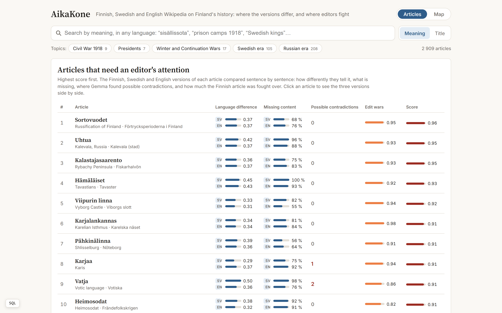
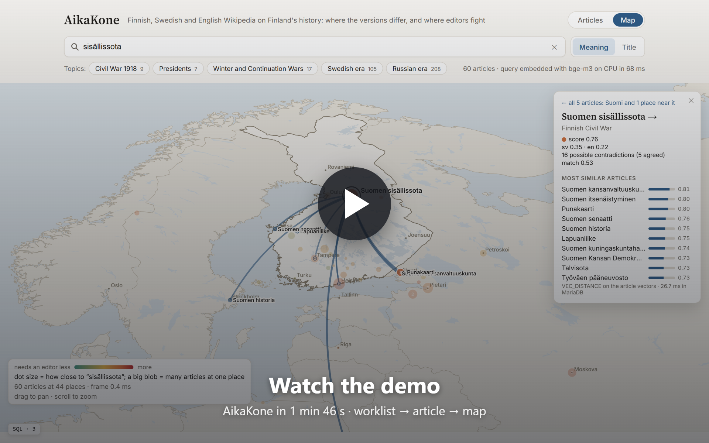
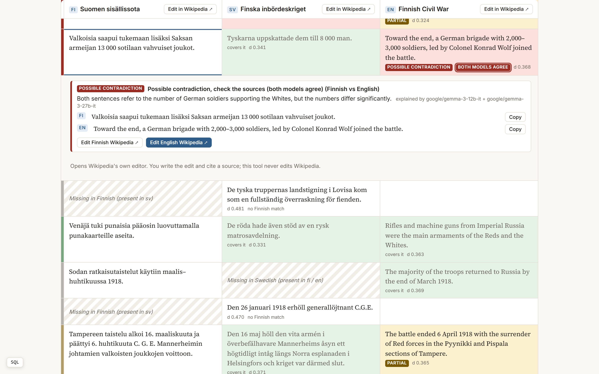
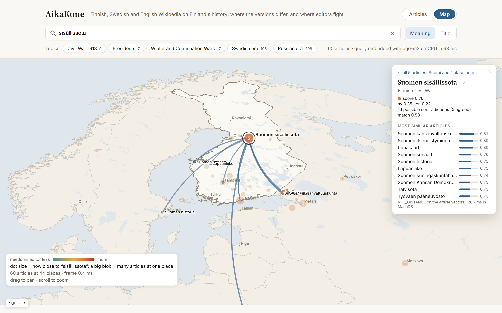
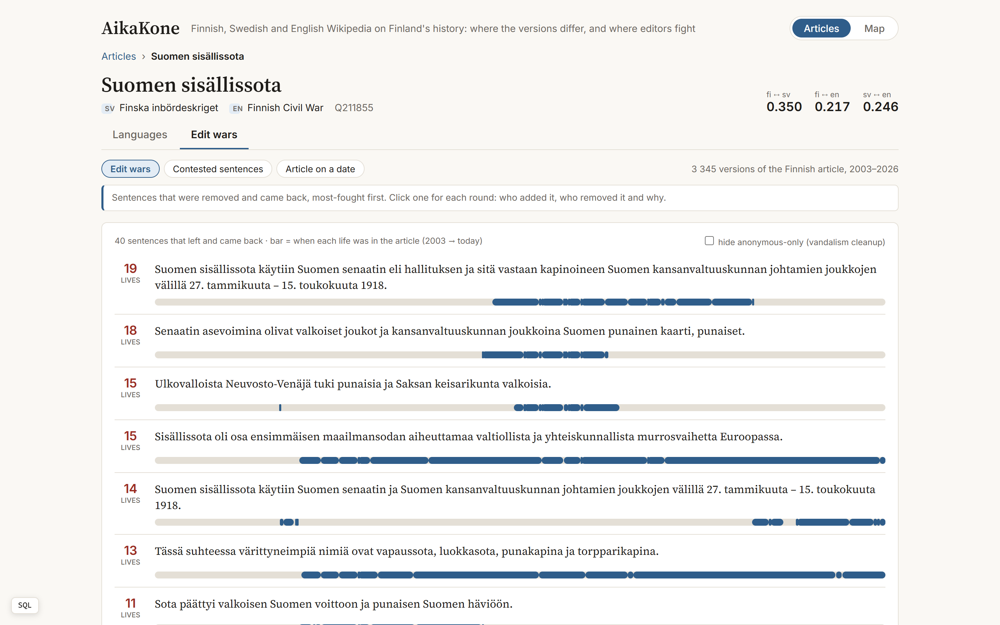
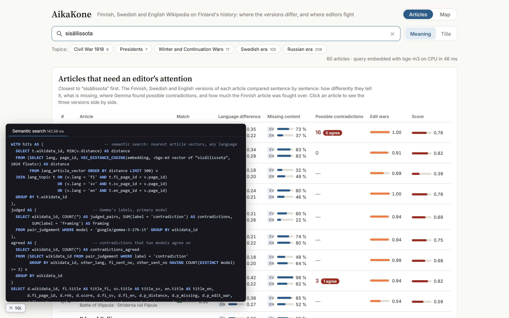
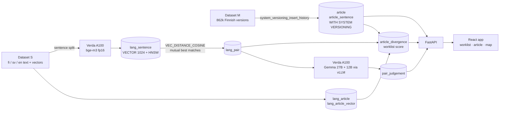

<div align="center">

# AikaKone

**Where Finnish, Swedish and English Wikipedia tell Finland's history differently, and where editors
fight over it.**

A tool for Wikipedia editors, built on MariaDB vector search and system-versioned tables.

*Junction 2026 · MariaDB "Wikipedia Through Time" challenge (vector search **and** system-versioned
tables) · Best Use of Gemma · Verda Compute track*



### ▶ [Watch the demo video (1 min 46 s)](docs/demo/aikakone-demo.webm)

[](docs/demo/aikakone-demo.webm)

</div>

## What it does

The same article exists in Finnish, Swedish and English, but the three versions are written by
different people and drift apart. The Tavastians (*Hämäläiset*) "are a people" in Finnish but "were a
tribe" in Swedish and English; the Finnish article on the 1918 civil war gives the date of
Mannerheim's resignation as 27 May, the English one 25 May; whole paragraphs exist in only one
language. AikaKone finds these problems across **2,919 articles** and takes an editor straight to them.

1. **Worklist.** Every article that exists in all three languages, ranked by how differently the
   versions tell it, how much content is missing, how many possible contradictions Gemma found, and how
   fiercely the Finnish article has been edit-warred. Narrow it with:
   - **semantic search**: "prison camps 1918" (in English) finds the Finnish *vankileiri* articles that
     never use those words;
   - **topic chips**: a Finnish Wikipedia category and all its subcategories;
   - title search.
2. **Article page.**
   - **Languages:** the three versions aligned sentence by sentence. Each sentence is marked as
     matching, missing, a different framing, or a possible contradiction, with Gemma's reasoning. The
     contradictions two models agree on come first. One click opens Wikipedia's own editor;
     **a human writes the edit**.
   - **Edit wars:** the Finnish article's history. Sentences that were deleted and restored again and
     again, how contested each sentence is, and the article as it was on any date.
3. **Map.** The same articles at their places on a world map. Pick one to draw lines to its ten
   most similar articles.

Every view shows the exact MariaDB SQL behind it (the **SQL** button).

| Possible contradiction, and the editor link | The map: an article and its 10 most similar |
|---|---|
|  |  |
| **Edit wars in the Finnish history** | **Semantic search, with its SQL** |
|  |  |

## Highlights

| | |
|---|---|
| **Data** | 19,742 Finnish articles with **862,076 versions** (2003–2026), loaded with their real save times. Current fi / sv / en text for 29,460 articles; **2,919 topics in all three languages** |
| **Vectors** | 29,460 article vectors and **358,553 sentence vectors** (bge-m3, 1,024 dimensions) in MariaDB `VECTOR` columns with HNSW indexes |
| **GPU** | All sentences embedded on a Verda A100 in **124 s (2,892 sentences/s, €0.07)**: ~445× the laptop CPU, which would have needed ~15 hours |
| **LLM** | Gemma 3 27B judged **7,399 sentence pairs** on Verda (7,401 sent, 2 failed; vLLM, 3.3 pairs/s, **€1.34**). Gemma 3 12B rechecked its 269 contradictions as a second opinion; the two models agree on 47 |
| **Privacy** | Open models (bge-m3, Gemma) self-hosted on a European GPU (Verda): no text was sent to a third-party AI API |
| **Speed** | Every step of the demo responds in under half a second: semantic search ~300 ms including the CPU embedding of the query, similar articles ~30 ms, a map redraw < 2 ms |

## How it works



**1. Whole articles.** `VEC_DISTANCE_COSINE` between the fi / sv / en article vectors. A much shorter
version is always far away, so the distance is corrected for length: a least-squares fit over all
2,919 topics removes what the length ratio explains (≈25 %), and the residual is ranked.

**2. Sentences.** Every sentence is matched to its nearest sentence in the other two languages. A pair
counts as aligned when both sentences are each other's best match and the distance is under **0.418**:
the 5th percentile of distances to sentences of *unrelated* articles, so a closer match is very unlikely
to be chance. A sentence with nothing that close is **missing** in the other language.

**3. Judgement.** Gemma reads each aligned pair, first states the specific claim each sentence makes,
then labels the pair: same, partial, different framing, or contradiction. A contradiction is only
allowed when both sentences make a claim about the very same fact. The labels are evaluated on 50
hand-labelled pairs (below).

**4. History.** Dataset M's 862,076 versions are replayed into MariaDB with their original timestamps.
Every sentence's life becomes a row in a system-versioned table, so "this sentence was removed and
restored 19 times" is a `GROUP BY … HAVING` over `FOR SYSTEM_TIME ALL`.

**Score** = 30 % language difference + 30 % missing content (both length-corrected percentiles) +
40 % edit-war activity.

### The MariaDB in it

Semantic search: the query embedded with bge-m3, compared with article vectors in all three languages
(the vector index sits in a subquery so the optimiser uses it):

```sql
WITH hits AS (
  SELECT t.wikidata_id, MIN(v.distance) AS distance
  FROM (SELECT lang, page_id, VEC_DISTANCE_COSINE(embedding, ?) AS distance
        FROM lang_article_vector ORDER BY distance LIMIT 300) v
  JOIN lang_topic t ON (v.lang = 'fi' AND t.fi_page_id = v.page_id)
                    OR (v.lang = 'sv' AND t.sv_page_id = v.page_id)
                    OR (v.lang = 'en' AND t.en_page_id = v.page_id)
  GROUP BY t.wikidata_id)
SELECT … FROM article_divergence d JOIN hits h USING (wikidata_id) ORDER BY h.distance;
```

Topic chips: a category and its subcategories, walked recursively:

```sql
WITH RECURSIVE cat (name, depth) AS (
  SELECT CAST('Suomen sisällissota' AS VARCHAR(255)), 0
  UNION
  SELECT l.child, c.depth + 1 FROM cat c JOIN category_link l ON l.parent = c.name WHERE c.depth < 2)
SELECT ac.page_id FROM cat JOIN article_category ac ON ac.category = cat.name;
```

Edit wars: sentences with more than one life in the system-versioned history:

```sql
SELECT sent_hash, COUNT(*) AS lives
FROM article_sentence FOR SYSTEM_TIME ALL
WHERE page_id = 1150
GROUP BY sent_hash HAVING COUNT(*) > 1
ORDER BY lives DESC;
```

Also used: `FOR SYSTEM_TIME AS OF` (the article on any date), `FOR SYSTEM_TIME FROM … TO` (which place
an article linked most in a year), an application-time `PERIOD FOR event_time` (bitemporal: the "About
events in 1917–1918" filter in the *Article on a date* view shows what the article said *then* about
events of *those years*), and window functions throughout.

## Results, honestly

- **Gemma's judgements** on 50 hand-labelled pairs (v2 prompt): **27B 70 % accuracy** vs 12B 56 %.
  Contradiction precision is the weak point: about half of single-model contradictions are false alarms,
  typically two sentences about different scopes (combat deaths vs all deaths). So the app never states
  a contradiction as fact: it says **"Possible contradiction, check the sources"**, and the
  contradictions both models agree on come first. On the hero article, checked by hand, 7 of the 27B's
  15 contradictions were real (47 %) and **3 of the 4** that both models agreed on: a small sample, but
  agreement is the better signal.
- **Coverage:** Gemma judged the 301 most urgent articles for the demo (the top 300 of the ranking at
  the time, plus the Sauli Niinistö article); the rest say "not judged in demo".
- **The top of the worklist is real:** *Hämäläiset* is "a people" in Finnish but "a tribe" (past tense)
  in Swedish and English; *Viipurin linna* starts from a Karelian trading post in Finnish and from the
  Swedish founding in 1293 in the others; the volunteer count for the *Heimosodat* differs (≈9,000 vs
  ≈10,000).
- **Border places dominate the top:** *Uhtua*, *Kalastajasaarento* and *Karjalankannas* are places on
  the Finnish–Russian border. Each language tells the place's history from its own country's present:
  the Finnish articles tell the Finnish past (the village's history, Petsamo, the municipalities ceded
  in 1944), while the English ones describe today's Russian town, peninsula and isthmus.
- **Map positions:** two thirds of the positions are inferred: the place the article links to most.

The full build log, with every decision and measurement, is in [NOTES.md](NOTES.md); the GPU and
LLM runs, with times and costs, are in [docs/process-log.md](docs/process-log.md).

## Run it

Needs MariaDB 11.8+ (vector support), Python 3.11+, Node 18+. Database settings go in `.env`
(copy `.env.example`).

```bash
pip install -r requirements.txt
python start.py        # checks MariaDB, builds the web app if needed, serves http://127.0.0.1:8000
```

### Data pipeline

| Step | Command |
|---|---|
| Download dataset M (parquet, into `data/m/`) | `python -m ingest.download --all` |
| Dataset M (19,742 Finnish articles, 862,076 versions, system-versioned) | `python -m ingest.load_parquet --list all` |
| Sentence history for the edit-war views | `python -m ingest.replay --dataset large --sentences-only` |
| Dataset S (current fi / sv / en text + bge-m3 article vectors; release files in `data/s/`) | `python -m ingest.load_lang` |
| Category tree for the topic chips | `python -m ingest.load_categories` |
| Sentence vectors (bge-m3 on a GPU: `scripts/verda/embed_sentences.py`) | `python -m ingest.load_verda_sentences` |
| Sentence matching (mutual best matches, threshold 0.418) | `python -m db.lang_match --workers 8` |
| Gemma judgements (vLLM on a GPU: `scoring/judge_pairs.py`) | `python -m ingest.load_judgements` |
| Places on the map | `python -m ingest.places --all`, `python -m ingest.place_links --all`, `python -m ingest.geo`, `python -m ingest.build_origin` |
| Map positions | `python -m db.build_topic_place` |
| Worklist scores | `python -m db.build_divergence` |

Tests: `python -m pytest`. A browser run of the whole demo, with screenshots and timings:
`cd web && npm run demo-flow`. A captioned demo video (WebM, 1920×1080) of the same path: `cd web && npm run demo-video`
(saved as `data/aikakone-demo.webm`; the one in the README is `docs/demo/aikakone-demo.webm`).

## Project layout

```
api/        FastAPI: explore.py (worklist, search, chips, map), editor.py (fi/sv/en compare),
            main.py + history.py (the Finnish article's history), db.py (connection pool)
common/     MariaDB connection, schema, bge-m3 query embeddings
db/         schema.sql, one SQL file per history view, sentence matching, worklist score
ingest/     loaders: datasets M and S, sentence history, GPU sentences, judgements, categories, places
scoring/    Gemma: pair judging and its evaluation (run on Verda), sentence scoring
scripts/    GPU embedding job for Verda, map coastline builder
web/        React + Vite: worklist, article page, map (canvas, Equal Earth projection)
docs/       contracts between the parts, decisions, Verda process log, screenshots
```

## Team

Built in 48 hours at Junction 2026 by:

- **Jussi Grönroos**
- **Kristian Lalev**
- **Jesse Mahkonen**
- **Iikka Harjamäki** 

## Licence

Code: [MIT](LICENSE). Wikipedia text and everything derived from it:
[CC BY-SA 4.0](https://creativecommons.org/licenses/by-sa/4.0/), credit Wikipedia and its authors.
Datasets: [MariaDB/mariadb-wikipedia-datasets](https://github.com/MariaDB/mariadb-wikipedia-datasets).
Map data: [Natural Earth](https://www.naturalearthdata.com/) (public domain).
